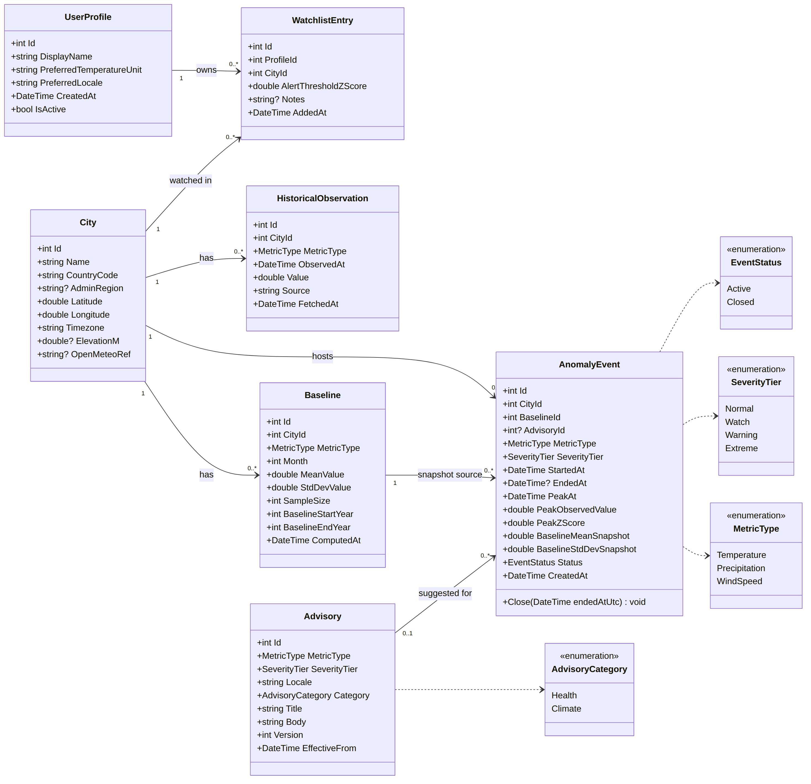
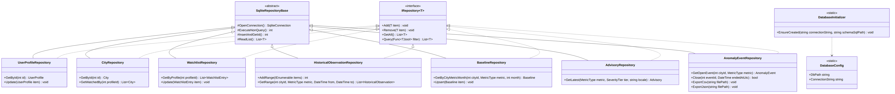
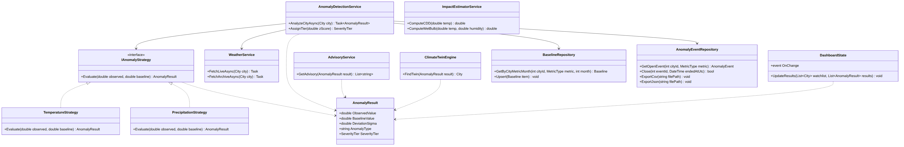

# ClimaPulse

A desktop climate intelligence suite designed to monitor, analyze, and detect global extreme weather anomalies by continuously cross-referencing live weather feeds against 30-year historical climate baselines.

"Mendoan"

GROUP LEADER : NALEN RADITYA SADEWA - 536801  
- Member 1 : ARYA RADITYA ARDANA - 536660
- Member 2 : CHRISTANIA PUTRI RACHMADEWI - 532874  
- Member 3 : MUHAMMAD IBRAHIM ASY SYAUQI WAHYUAJI - 5327610


PROJECT STRUCTURE (monorepo)

ClimaPulse is a Windows desktop app: a WPF window whose screens are Blazor components (Blazor Hybrid). Everything runs in one program on .NET 10. There is no web server.

```
.
|-- frontend/    ClimaPulse.Desktop: WPF window + BlazorWebView, Razor screens (Windows only)
|   |-- Components/     Dashboard.razor (more screens to come)
|   `-- State/          DashboardState.cs (UI state shared by screens)
|-- backend/     ClimaPulse.Backend: services, repositories, WeatherService, SQLite
|   |-- Database/       schema.sql, seed.sql, schema.dbml
|   |-- Enums/  Models/  Repositories/  Services/  Strategies/
|   `-- .env.example    CLIMAPULSE_DB_PATH and Open-Meteo URL names
|-- shared/      ClimaPulse.Contracts: interfaces, DTOs, enums, exceptions (planned)
`-- docs/        SRD, contract, architecture, design references, class diagrams
```

The screens only use the interfaces in `shared/ClimaPulse.Contracts`, and the backend implements them, so the frontend and backend cannot drift apart without the build failing. C# namespaces stay `ClimaPulse.*`.

DOCUMENTATION

| Document | What it is |
|---|---|
| `docs/SRD.md` | Requirements, constraints, grading criteria, open decisions |
| `docs/api-contract.md` | The contract between frontend and backend (interfaces, DTOs, errors) |
| `docs/references-desktop-architecture.md` | Architecture, project setup, links, pitfalls |
| `docs/design-references.md` | Screens, colors, accessibility |
| `docs/github-ai-agent-rules.md` | Git and AI tool rules for the team |

RUN AND DEMO

- Requirements: Windows 10 (build 17763) or later, 64-bit, .NET 10 SDK, Visual Studio 2022 or newer with ".NET desktop development".
- Run from source: open the solution and start `ClimaPulse.Desktop` (the solution is not set up yet, see `docs/references-desktop-architecture.md`).
- Demo build: a zip on GitHub Releases (link to be added when the first build exists).
- Usage: pick or create a profile, add a city, press Refresh, open a city for details, open the Ledger to filter and export.

MODULE 3

Class diagram, updated to match the 7-table database (UserProfile, City, Watchlist, HistoricalObservation, Baseline, Advisory, AnomalyEvent). Mermaid sources are in `docs/class-diagram/`.

**1. Domain model and enums**



**2. Data access layer**



**3. Services and strategies**



<details><summary>Previous version (before the database alignment)</summary>


</details>
