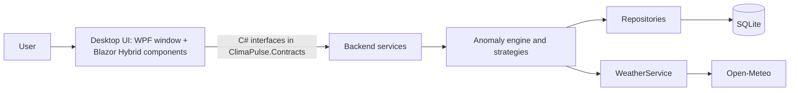

# ClimaPulse: Software Requirements Document (SRD)

| | |
|---|---|
| Version | 0.2 draft |
| Date | 2026-10-22 |
| Project | ClimaPulse, Junior Project, group "Mendoan", UGM DTETI |
| Status | For team review. Items marked **OPEN** need a team decision. |
| Based on | Module 1 project brief and grading criteria, README, Modul 3 class diagram, Modul 4 database (`backend/Database/schema.sql`), design decisions recorded in the project docs |

---

## 1. Introduction

### 1.1 Purpose
This document states what ClimaPulse must do and the limits it must work within. It is the reference for building, testing and grading the system. Each requirement has an ID so code, tests and pull requests can point back to it.

### 1.2 Scope
ClimaPulse is a Windows desktop application that monitors, analyzes and detects extreme weather anomalies. It compares live weather readings against 30-year historical climate baselines using a z-score, so users see how unusual a reading is, not just the number.

The system:
- lets a user keep a watchlist of cities from around the world,
- fetches live and historical weather data from Open-Meteo,
- computes monthly baselines per city and metric,
- classifies each reading into a severity tier,
- shows health and climate advisories for the active tier,
- records every anomaly episode in a historical ledger that can be exported as CSV or JSON.

Out of scope for version 1 are listed in section 6.

### 1.3 Platform note
Module 1 requires the application to be written in C# as a desktop application (Windows Store, Windows Forms or WPF). ClimaPulse is a **WPF application that hosts its user interface with Blazor Hybrid** (`BlazorWebView`): the window is WPF, the screens are Razor components, and everything runs on .NET inside one process on the user's PC.

There is no web server and no HTTP API between the screens and the logic. The screens call C# service interfaces directly (section 4.2). Version 0.1 of this SRD described a web app with an HTTP API. That design is replaced.

### 1.4 Definitions

| Term | Meaning |
|---|---|
| Z-score | `(observed value - baseline mean) / baseline standard deviation`. How many standard deviations a reading is from normal. |
| Baseline | Mean and standard deviation of a metric for one city and one calendar month, computed from about 30 years of history. |
| Metric | A measured quantity: `temperature_2m`, `precipitation` or `wind_speed_10m`. |
| Severity tier | Normal, Watch, Warning or Extreme. Only Watch, Warning and Extreme are stored. |
| Anomaly event | One continuous episode in which a metric stays beyond the threshold for a city. It has a start, a peak and an end. |
| Ledger | The Historical Anomaly Ledger, the `AnomalyEvent` table. |
| Hysteresis | A small margin between the opening and closing thresholds so a reading hovering near the limit does not open and close events repeatedly. |
| Watchlist | The cities a user follows, with a per-city alert threshold. |
| Advisory | A short health or climate message tied to a metric and tier. |

### 1.5 References
- `README.md`, `docs/class-diagram/` (Module 3)
- `backend/Database/schema.sql`, `schema.dbml`, `seed.sql` (Module 4)
- `docs/references-desktop-architecture.md`
- `docs/api-contract.md` (the frontend and backend contract)
- Module 1, Junior Project brief and assessment criteria
- `docs/github-ai-agent-rules.md`
- Open-Meteo documentation: https://open-meteo.com/en/docs (check before relying on limits)

---

## 2. Overall description

### 2.1 Product perspective
One desktop program built from three projects in one repository (frontend, backend, shared contracts):

### 2.2 User classes

| User | Description | Main needs |
|---|---|---|
| End user | Anyone who wants to know if the weather in some places is unusual. No technical skill assumed. | Add cities, see risk at a glance, read advice. |
| Analyst | A student or researcher who reviews past events. | Filter the ledger and export data. |
| Maintainer | A team member. | Seed advisories, refresh baselines, inspect health of the system. |

### 2.3 Operating environment
Windows 10 (version 1809, build 17763) or later, or Windows 11, 64-bit. The Microsoft Edge WebView2 Runtime must be present (it is part of current Windows installs; check the demo laptop). .NET 10. A SQLite file on the user's PC. Internet access to Open-Meteo for live data and first-time history downloads.

### 2.4 Constraints
- C-1: C# on .NET 10 LTS. WPF with Blazor Hybrid (`BlazorWebView`) for the desktop UI. SQLite through `Microsoft.Data.Sqlite`. Required by Module 1: C# desktop application.
- C-2: Open-Meteo is the only weather data source. Its free tier is for non-commercial use with request limits (confirm the exact numbers on the terms page).
- C-3: Layering: Razor components depend only on `ClimaPulse.Contracts` interfaces. The UI never accesses repositories or the database, and only `WeatherService` calls Open-Meteo.
- C-4: All timestamps are stored in UTC as ISO 8601 text.
- C-5: The project is a university group project with a fixed schedule and four members, so scope is prioritized (section 3). Module 1 states a maximum of three members per group, so the group size must be confirmed with the teaching assistant (OPEN-8).
- C-6: Work follows the Git rules in `docs/github-ai-agent-rules.md`.
- C-7: Grading (Module 1). Process 40 percent: teamwork, engineering design principles, alignment of deliverables, quizzes (10 percent each). Product 60 percent: documentation on GitHub with Git, demo access information and brief usage documentation (20), demo runs without errors (20), OOP design quality, originality and usefulness (20). Scope and priorities in this document follow these weights.

### 2.5 Assumptions and dependencies
- A-1: Open-Meteo stays available and keeps its variable names (`temperature_2m`, `precipitation`, `wind_speed_10m`).
- A-2: About 30 years of archive data exist for every city the user can add.
- A-3: Sample advisories are written by the team in Indonesian (`id-ID`) and English, loaded through `seed.sql`.
- A-4: The app is installed per PC. One person uses it at a time, and several local profiles can share one PC (demo scale, not production scale).

---

## 3. Functional requirements

Priority uses MoSCoW: **Must** (needed for the demo), **Should** (important), **Could** (if time remains), **Won't** (not in version 1).

### 3.1 Watchlist and cities

| ID | Requirement | Priority | Acceptance criteria |
|---|---|---|---|
| FR-01 | The user can search for a city by name and see matching results with country and region. | Must | Searching "Yogyakarta" returns at least one result with name, country code and coordinates. |
| FR-02 | The user can add a city to their watchlist. | Must | After adding, the city appears on the dashboard. Adding the same city twice is rejected with a clear message (unique profile and city). |
| FR-03 | The user can remove a city from the watchlist. | Must | The city disappears from the dashboard. Its observations and baselines remain for other users. |
| FR-04 | The user can set an alert threshold (z-score) and a note per watched city. | Should | Default threshold is 2.0. Values of 0 or less are rejected. Notes are at most 500 characters. |
| FR-05 | The user can set display preferences: temperature unit (C or F) and language (`id-ID` or `en-US`). | Should | Changing the unit converts every temperature shown. Data stored stays in Celsius. |

### 3.2 Data ingestion and baselines

| ID | Requirement | Priority | Acceptance criteria |
|---|---|---|---|
| FR-06 | The system fetches current weather for each watched city from Open-Meteo. | Must | A refresh returns a reading per metric per city, or a visible error for that city without breaking the others. |
| FR-07 | The system fetches about 30 years of archive data for a city when it is first added and stores it as observations. | Must | Re-fetching the same period inserts no duplicate rows (unique city, metric, time). |
| FR-08 | The system computes and stores a baseline (mean, standard deviation, sample size, start and end year) for each city, metric and calendar month. | Must | There is exactly one baseline row per city, metric and month. Refreshing updates the row and keeps its id. |
| FR-09 | A maintainer can trigger a baseline refresh for a city. | Should | Refresh finishes and the `computed_at` time changes. |

### 3.3 Anomaly detection

| ID | Requirement | Priority | Acceptance criteria |
|---|---|---|---|
| FR-10 | The system computes the z-score of a live reading against the matching baseline. | Must | For mean 28.0, standard deviation 1.5 and reading 33.0, the z-score is about 3.33. A standard deviation of 0 does not crash the system and yields no anomaly. |
| FR-11 | The system assigns a severity tier from the z-score. | Must | Thresholds are configurable in one place. Proposed defaults are in OPEN-1. |
| FR-12 | Temperature anomalies are supported first. | Must | The temperature strategy is complete and tested. |
| FR-13 | Precipitation anomalies are supported. | Should | Precipitation strategy complete and tested, with the known limits of rain data documented (skewed distribution, many zero values). |
| FR-14 | Wind speed anomalies are supported. | Could | Wind strategy added using the same strategy interface. |
| FR-15 | The system finds the "climate twin" city whose normal climate matches today's anomaly. | Could | `ClimateTwinEngine` returns a city from the candidate list and the UI shows it. |
| FR-16 | The system estimates impact values (cooling degree days, wet-bulb temperature). | Could | `ImpactEstimatorService` formulas are verified against a known example. |

### 3.4 Dashboard and advisories

| ID | Requirement | Priority | Acceptance criteria |
|---|---|---|---|
| FR-17 | The dashboard lists all watched cities with a risk badge (Normal, Watch, Warning, Extreme) per metric. | Must | The badge colour and text both show the tier, so colour is not the only signal. |
| FR-18 | The user can refresh all readings from the dashboard. | Must | A loading state shows while fetching and a time of last update is displayed. |
| FR-19 | For an active anomaly the user sees the matching advisory (health and climate) in their language. | Must | The advisory with the highest `version` whose `effective_from` is not in the future is shown. If none exists in the user's language, the `id-ID` advisory is shown. |
| FR-20 | The user can open a city detail view showing current value, baseline, z-score and recent history. | Should | The view shows the reading, baseline mean and standard deviation, and z-score for each metric. |
| FR-21 | The dashboard supports light and dark themes. | Could | Theme choice persists after the app is closed (local settings file). |

### 3.5 Historical Anomaly Ledger

| ID | Requirement | Priority | Acceptance criteria |
|---|---|---|---|
| FR-22 | The system opens an anomaly event when a reading crosses the threshold and none is open for that city and metric. | Must | One row is created with start time, peak, tier, and a snapshot of baseline mean and standard deviation. |
| FR-23 | While an event is open the system updates its peak and tier if the reading gets worse. | Must | Peak value, peak time and peak z-score reflect the worst reading. The tier never decreases within one event. |
| FR-24 | The system closes the event when readings return below the closing threshold. | Must | Status becomes `closed` and `ended_at` is set and not before `started_at`. |
| FR-25 | Sustained anomalies create one event, not one row per reading (event on transition with hysteresis). | Must | Ten consecutive anomalous readings produce a single event. |
| FR-26 | The user can browse the ledger and filter by city, metric, tier, status and date range. | Should | Filters combine. Results are newest first and paged. |
| FR-27 | The user can export the ledger (with the active filter) as CSV or JSON. | Must | A Save dialog lets the user choose the file. The file contains every column of `AnomalyEvent`. Numbers use a dot as decimal separator, also on an Indonesian Windows. |
| FR-28 | Past events never change when a baseline is recomputed. | Must | Recomputing a baseline leaves the event's snapshot columns unchanged. |

### 3.6 Users

| ID | Requirement | Priority | Acceptance criteria |
|---|---|---|---|
| FR-29 | The system supports user profiles with a display name, chosen in a profile picker. | Must | On start the app lists existing profiles and offers "New profile". The last used profile is preselected. Display name is 1 to 50 characters. |
| FR-30 | Authentication (passwords, accounts). | Won't (v1) | No login. Data is public weather data on the user's own PC, and authentication is not an assessment criterion. Decided in OPEN-3. |

---

## 4. External interface requirements

### 4.1 User interface
- UI-1: The window works from 1024 x 640 pixels up to full HD and adapts when resized.
- UI-2: Dashboard first. A user reaches the watchlist, ledger and settings in at most two clicks.
- UI-3: Every risk badge pairs colour with text. Interactive elements are keyboard reachable and have visible focus.
- UI-4: Loading, empty and error states are shown for every data view.
- UI-5: Indonesian is the default language, English is the second.

### 4.2 Internal interface between frontend and backend

The UI and the logic run in the same process. The contract is a set of C# interfaces, DTOs, enums and exception types in the project `shared/ClimaPulse.Contracts`, explained in `docs/api-contract.md`. If that document and the code disagree, the code wins.

| Interface and methods | Purpose | Requirement |
|---|---|---|
| `IProfileService`: `ListAsync`, `GetAsync`, `CreateAsync`, `UpdateAsync` | Profile picker, create and edit profiles and preferences | FR-05, FR-29 |
| `ICityService`: `SearchAsync`, `ListStoredAsync`, `GetAsync`, `AddAsync` | Search places by name and store one | FR-01, FR-20 |
| `IWatchlistService`: `ListAsync`, `AddAsync`, `UpdateAsync`, `RemoveAsync` | Manage watched cities, threshold and note | FR-02 to FR-04 |
| `IDashboardService`: `GetAsync` | Watched cities with current tier per metric, from stored data | FR-17 |
| `IMonitoringService`: `RefreshCityAsync` | Fetch live data, evaluate, open, update or close events | FR-06, FR-10 to FR-12, FR-18, FR-22 to FR-25 |
| `IBaselineService`: `ListAsync`, `RefreshAsync` | Show and recompute baselines, with progress | FR-07 to FR-09, FR-20 |
| `IAdvisoryService`: `GetLatestAsync` | Latest advisory for a metric, tier and language | FR-19 |
| `IEventLedgerService`: `ListAsync`, `GetAsync`, `ExportAsync` | Browse, filter, page and export the ledger | FR-26, FR-27 |

Errors are typed exceptions: `ValidationException` (invalid input), `NotFoundException` (unknown id), `ConflictException` (duplicate, or a job already running), `UpstreamException` (Open-Meteo failed). Anything else is treated as a bug.

Closing events is done by the system through the refresh flow, so there is no close method in version 1.

### 4.3 External service: Open-Meteo
- Forecast API for current values, archive API for history. Base URLs have defaults in `OpenMeteoOptions` and can be overridden by environment variables (names in `backend/.env.example`).
- Variables used: `temperature_2m`, `precipitation`, `wind_speed_10m`.
- The system must handle timeouts, empty responses and rate limit responses without crashing, and show the user which city failed.
- City search uses Open-Meteo's geocoding API.
- Anomalies compare today's daily value (daily mean temperature, daily rain total, daily maximum wind) with baselines built from daily archive values. The exact endpoints, variables, units and limits are in `docs/api-contract.md`, section 14.

### 4.4 Database
SQLite, schema in `backend/Database/schema.sql`, created automatically on first start. Foreign keys are enforced on every connection. The file lives in `%LOCALAPPDATA%\ClimaPulse\climapulse.db` unless `CLIMAPULSE_DB_PATH` is set, because an installed program folder is often not writable.

---

## 5. Non-functional requirements

Targets are starting points. The team should confirm them after measuring.

| ID | Category | Requirement |
|---|---|---|
| NFR-01 | Performance | Dashboard for 10 watched cities loads in under 3 seconds when data is cached in the database. |
| NFR-02 | Performance | The first-time 30-year import for one city completes in under 60 seconds and shows progress. |
| NFR-03 | Performance | Calls to Open-Meteo stay within its free limits (less than 600 per minute, 5,000 per hour, 10,000 per day and 300,000 per month per IP address, terms page checked 2026-10-22). The system caches archive data and does not refetch periods it already holds. |
| NFR-04 | Reliability | A failure for one city or one metric does not stop the others. |
| NFR-05 | Data integrity | All database constraints in `schema.sql` stay enabled. The application never bypasses them. |
| NFR-06 | Data integrity | An active event never has an end time. A closed event ends at or after its start. (Enforced by a database CHECK.) |
| NFR-07 | Security | No secrets in the repository. `.env` and `*.db` are ignored by git. |
| NFR-08 | Security | All SQL uses parameters. User input is validated in the backend services, even when the UI already checked it. |
| NFR-09 | Security | The app makes outbound network calls only to Open-Meteo. |
| NFR-10 | Usability | A first-time user can add a city and read its risk level without instructions. |
| NFR-11 | Accessibility | Aim for WCAG 2.1 AA colour contrast on badges and text. |
| NFR-12 | Maintainability | Layers stay separated (C-3). New metrics are added by adding a strategy, not by editing existing ones. |
| NFR-13 | Testability | The anomaly engine and strategies have unit tests that need no network or database. |
| NFR-14 | Portability | The app runs on Windows 10 (build 17763) or later, 64-bit. The Contracts and Backend projects and their tests build on any OS with the .NET 10 SDK. |
| NFR-15 | Localization | User-facing text lives in resource files, not in component code. |
| NFR-16 | Deployment | The demo build is a self-contained publish that starts with a double-click on a PC without the .NET SDK. A release zip and run instructions are on GitHub (Module 1: demo access information). |
| NFR-17 | Reliability | The window stays responsive during refresh and baseline downloads, and an unexpected error in one screen does not close the app. |

---

## 6. Out of scope for version 1

- Push, email or SMS notifications.
- Native mobile apps, a web version and a public HTTP API.
- User accounts, passwords and login.
- Forecast of future anomalies (only live readings versus baseline).
- Real-time streaming. Readings are fetched on refresh or on a timer.
- Advisory editing screen (advisories come from `seed.sql`).
- Commercial use of Open-Meteo data.

---

## 7. Data requirements (from the implemented schema)

| Entity | Purpose | Key rules |
|---|---|---|
| UserProfile | A person using the app | Name 1 to 50 chars. Unit C or F. Locale up to 10 chars. |
| City | A place that can be watched | Country code is 2 letters. Latitude within -90 and 90, longitude within -180 and 180. |
| Watchlist | Links a profile to a city (many to many) | Unique per profile and city. Threshold above 0, default 2.0. Deleted with the profile or the city. |
| HistoricalObservation | Stored readings | Unique per city, metric and time. Deleted with the city. |
| Baseline | Mean and standard deviation per city, metric, month | Unique per city, metric and month. Standard deviation 0 or more. Month 1 to 12. |
| Advisory | Health or climate message | Unique per metric, tier, locale and version. Tier is watch, warning or extreme. Body up to 2000 chars. |
| AnomalyEvent | The ledger | Cannot be removed together with its city or baseline (restrict). Keeps baseline snapshots. Advisory link is optional. |

Retention: observations and baselines are kept as long as the city exists. Ledger events are kept permanently. Deleting a city that has ledger events is blocked by the database on purpose.

---

## 8. Traceability

| Requirement group | Database | Code (current names) |
|---|---|---|
| Watchlist (FR-01 to FR-05) | City, Watchlist, UserProfile | `CityRepository`, `WatchlistRepository`, `UserProfileRepository` |
| Ingestion and baselines (FR-06 to FR-09) | HistoricalObservation, Baseline | `WeatherService`, `HistoricalObservationRepository`, `BaselineRepository` |
| Detection (FR-10 to FR-16) | Baseline | `AnomalyDetectionService`, `IAnomalyStrategy`, `TemperatureStrategy`, `PrecipitationStrategy`, `ClimateTwinEngine`, `ImpactEstimatorService` |
| Dashboard and advisories (FR-17 to FR-21) | Advisory | `IDashboardService`, `IAdvisoryService`, `AdvisoryService`, `AdvisoryRepository`, `DashboardState` (frontend) |
| Ledger (FR-22 to FR-28) | AnomalyEvent | `IEventLedgerService`, `AnomalyEventRepository` |
| Users (FR-29) | UserProfile | `IProfileService`, `UserProfileRepository` |

Known gaps: `AnomalyDetectionService.AnalyzeCityAsync` and `AssignTier` are not implemented yet. `WindStrategy` does not exist yet (needed for FR-14). The `ClimaPulse.Contracts` project and the service classes that implement its interfaces do not exist yet. `frontend/Dashboard.razor` still uses `ClimaPulse.Models` entities and must switch to DTOs.

---

## 9. Open questions (team decisions needed)

**OPEN-1: Tier thresholds and hysteresis.**
Proposal: Normal below 2.0, Watch from 2.0, Warning from 3.0, Extreme from 4.0 (absolute z-score), and an event closes when the z-score falls below the opening threshold minus 0.25.
- Pros: easy to explain, 2 sigma is a common "unusual" level, per-city threshold already exists in the schema.
- Cons: weather is not perfectly normal, so rain in particular will not follow these numbers. Cold anomalies and hot anomalies need the sign decided (the schema stores only the tier and the z-score, so the sign of the z-score tells the direction).
- Alternative: percentile-based tiers. More accurate for skewed data, more work and harder to explain.

**OPEN-2: Which metrics ship first.**
Recommendation: temperature as Must, precipitation as Should, wind as Could (earlier design notes say rain and flash drought are much harder than temperature).
- Pros: guarantees a working demo. Cons: the dashboard looks thin if only one metric works.

**OPEN-3: Authentication. DECIDED 2026-10-22: no login, profile picker.**
On start the app shows a profile picker (FR-29). There are no passwords.
- Why: the data is public weather data on the user's own PC, Module 1 does not grade authentication, and login would take time from the Must features and add ways for the demo to fail.
- Accepted cost: anyone using the same PC can open any profile. The report says so plainly.

**OPEN-4: Demo setup. DECIDED 2026-10-22: desktop app on a Windows laptop.**
Still to decide: which laptop runs the final demo, and whether the demo starts from an empty database or from `seed.sql` plus pre-downloaded baselines (recommended, so the demo does not depend on a slow first download).

**OPEN-5: Scheduling.**
Are live readings fetched only when the user presses refresh, or also by a background timer? A timer needs a hosted background service and more care with Open-Meteo limits.

**OPEN-6: Languages.**
Indonesian and English both, or Indonesian only? Doing both doubles advisory writing.

**OPEN-7: Course constraints. PARTLY ANSWERED by Module 1.**
Known: C# desktop app, Git on GitHub, a README with group members, a GitHub Page from the `docs` folder on `main`, demo access information, brief usage documentation, and the grading weights in C-7. Still unknown: whether later modules require specific diagrams, test evidence or a fixed SRD template.

**OPEN-8: Group size.**
Module 1 says groups have at most three members, but the group has four. Confirm with the teaching assistant that four is accepted and how roles (software architect, backend developer, frontend developer) are split across four people.

---

## 10. Revision history

| Version | Date | Change |
|---|---|---|
| 0.1 | 2026-10-16 | First draft from the existing schema, class diagrams and team decisions |
| 0.2.1 | 2026-10-22 | Open-Meteo details: geocoding confirmed, daily-value comparison, real free-tier limits (NFR-03) |
| 0.2 | 2026-10-22 | Platform changed to a WPF desktop app with Blazor Hybrid (Module 1). HTTP API replaced by in-process interfaces. No login, profile picker. Grading criteria added. OPEN-3 and OPEN-4 decided, OPEN-8 added |
