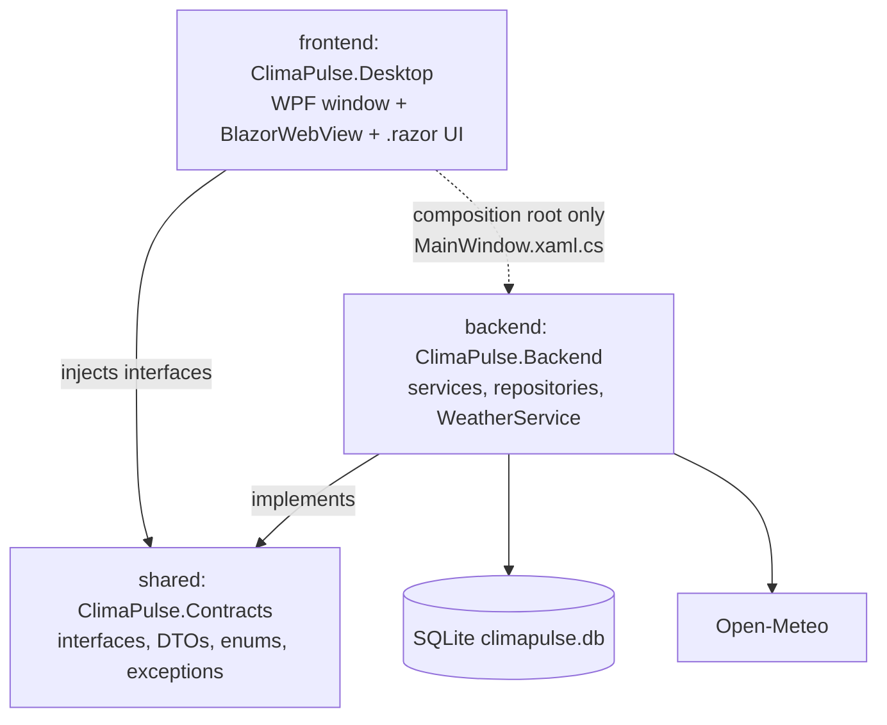

# ClimaPulse Internal API Contract (v2)

Status: draft for team approval. Last updated 2026-10-22.

This document is the agreement between the **frontend** (Razor components in the desktop app) and the **backend** (services, repositories, Open-Meteo access). Both sides build against the same C# interfaces and DTOs in `shared/ClimaPulse.Contracts`. That project **is** the contract. This file explains it and the rules around it. If the two ever disagree, the code in `shared/ClimaPulse.Contracts` wins and this file gets fixed.

Derived from `docs/SRD.md` (version 0.2) and `backend/Database/schema.sql`.

---

## 1. What changed from v1 and why

Version 1 (2026-10-17) was an HTTP contract (`openapi.yaml`) for a web app. Module 1 requires a C# desktop application, so the team chose **WPF with Blazor Hybrid** (`BlazorWebView`) and runs everything **in one process**. The UI calls C# interfaces directly, so there is no HTTP, no JSON between frontend and backend, and no `openapi.yaml`.

| | v1 (HTTP, retired) | v2 (in-process, current) |
|---|---|---|
| Contract file | `docs/openapi.yaml` | `shared/ClimaPulse.Contracts` (C#) |
| A field renamed on one side | Found at runtime, maybe in the demo | **Build fails** on the other side |
| Errors | HTTP status + Problem Details | Typed exceptions (section 7) |
| Frontend work before backend is ready | Prism mock server | Fake service classes (section 10) |
| Things that can break in a demo | Ports, CORS, API not started | None of those exist |

**Cost of the change:** if the team later wants a web or phone client, it needs an HTTP layer on top of these same interfaces. That is additive work, and the interfaces stay valid.

---

## 2. How to use it

| You are | Do this |
|---|---|
| Backend developer | Implement the interfaces in `backend/`. Return DTOs, never `ClimaPulse.Models` entities. Throw only the exceptions in section 7 on purpose. |
| Frontend developer | Inject the interfaces into components (`@inject IDashboardService Dashboard`). Never inject a repository, `WeatherService` or any class from `backend/`. Use the fakes until the backend is ready. |
| Reviewer | If a PR touches `shared/ClimaPulse.Contracts`, it needs one frontend and one backend reviewer (section 11). If a `.razor` file injects anything outside `ClimaPulse.Contracts`, request changes. |
| AI agent | Read this file before touching a service, DTO or component. Never invent a method, field or exception type. |

---

## 3. Projects and who may reference whom



| Project | Target | May reference | Must not reference |
|---|---|---|---|
| `shared/ClimaPulse.Contracts` | `net10.0` | nothing | anything |
| `backend` (ClimaPulse.Backend) | `net10.0` | Contracts, `Microsoft.Data.Sqlite` | Desktop, WPF |
| `frontend` (ClimaPulse.Desktop) | `net10.0-windows10.0.17763.0` | Contracts; Backend **only** in `MainWindow.xaml.cs` to register services | Backend classes inside any `.razor` file |

Contracts and Backend target plain `net10.0`, so their unit tests also run on Mac or Linux. Only the Desktop project needs Windows.

---

## 4. Conventions

| Topic | Rule |
|---|---|
| Names | C# PascalCase. Interfaces start with `I`. DTOs end with `Dto`, inputs end with `Request`. |
| Namespaces | DTOs, requests, interfaces and exceptions in `ClimaPulse.Contracts`. Enums keep `ClimaPulse.Enums` (moved from `backend/Enums` without renaming, so existing code still compiles). |
| Enums | The UI uses the C# enums. Strings like `"warning"` appear only in the database and in export files (section 9). |
| Time | Every `DateTime` is UTC (`DateTimeKind.Utc`). The UI converts to local time for display. |
| Units | Temperatures are always Celsius in the contract. The UI converts to Fahrenheit when the profile asks (FR-05). |
| Numbers | `double` for measurements and z-scores, `int` for ids (from SQLite, start at 1). |
| Null | Only fields marked `?` can be null. Nullable reference types are on, so the compiler warns. |
| Lists | Methods return `IReadOnlyList<T>`. Empty means `[]`, never `null`, and never an exception. |
| Async | Every method is `async` and takes an optional `CancellationToken`, so a slow Open-Meteo call can be cancelled when the user leaves the page. |
| Identity | No login. The active profile id comes from the profile picker (SRD FR-29) and is passed into each call. |

---

## 5. Service interfaces

These replace the 19 HTTP endpoints of v1. The comment at the end of a line names the exceptions that method can throw.

```csharp
using ClimaPulse.Enums;

namespace ClimaPulse.Contracts;

// The UI (frontend) depends only on these interfaces. The backend implements them.
// Every method may throw the exceptions in Errors.cs and nothing else on purpose.

public interface IProfileService
{
    Task<IReadOnlyList<ProfileDto>> ListAsync(CancellationToken ct = default);               // FR-29 picker
    Task<ProfileDto> GetAsync(int profileId, CancellationToken ct = default);                // NotFound
    Task<ProfileDto> CreateAsync(CreateProfileRequest request, CancellationToken ct = default);  // Validation
    Task<ProfileDto> UpdateAsync(int profileId, UpdateProfileRequest request, CancellationToken ct = default); // FR-05
}

public interface ICityService
{
    /// <summary>Find places by name through Open-Meteo geocoding. Nothing is stored. FR-01.</summary>
    Task<IReadOnlyList<CitySearchResult>> SearchAsync(string query, CancellationToken ct = default); // Validation, Upstream
    Task<IReadOnlyList<CityDto>> ListStoredAsync(CancellationToken ct = default);
    Task<CityDto> GetAsync(int cityId, CancellationToken ct = default);                      // NotFound
    /// <summary>Store a search hit. Returns the existing city if the same place is already stored.</summary>
    Task<CityDto> AddAsync(CitySearchResult result, CancellationToken ct = default);         // Validation
}

public interface IWatchlistService
{
    Task<IReadOnlyList<WatchlistEntryDto>> ListAsync(int profileId, CancellationToken ct = default);  // FR-02
    Task<WatchlistEntryDto> AddAsync(int profileId, AddWatchlistRequest request, CancellationToken ct = default); // Conflict if already watched
    Task<WatchlistEntryDto> UpdateAsync(int profileId, int cityId, UpdateWatchlistRequest request, CancellationToken ct = default); // FR-04
    Task RemoveAsync(int profileId, int cityId, CancellationToken ct = default);             // FR-03, events are kept
}

public interface IDashboardService
{
    /// <summary>Reads stored data only. Never calls Open-Meteo. FR-17.</summary>
    Task<DashboardDto> GetAsync(int profileId, CancellationToken ct = default);
}

public interface IMonitoringService
{
    /// <summary>Fetch live data, compute z-scores, open, update or close events. FR-06, FR-10 to FR-12, FR-22 to FR-25.</summary>
    Task<RefreshResultDto> RefreshCityAsync(int cityId, CancellationToken ct = default);     // NotFound, Upstream
}

public interface IBaselineService
{
    Task<IReadOnlyList<BaselineDto>> ListAsync(int cityId, MetricType? metric = null, CancellationToken ct = default); // FR-20
    /// <summary>Slow (archive download). Progress reports 0 to 100. FR-07 to FR-09.</summary>
    Task<IReadOnlyList<BaselineDto>> RefreshAsync(int cityId, IProgress<int>? progress = null, CancellationToken ct = default); // Conflict if running, Upstream
}

public interface IAdvisoryService
{
    /// <summary>Latest version per category, falling back to id-ID when the locale has none. FR-19.</summary>
    Task<IReadOnlyList<AdvisoryDto>> GetLatestAsync(MetricType metric, SeverityTier tier, string locale, CancellationToken ct = default);
}

public interface IEventLedgerService
{
    /// <summary>Newest StartedAt first. Page starts at 1, PageSize 1 to 100. FR-26.</summary>
    Task<PagedResult<AnomalyEventDto>> ListAsync(EventQuery query, int page = 1, int pageSize = 20, CancellationToken ct = default);
    Task<AnomalyEventDto> GetAsync(int eventId, CancellationToken ct = default);              // NotFound
    /// <summary>Writes every matching event (no paging) to the stream. The UI owns the Save dialog. FR-27.</summary>
    Task ExportAsync(EventQuery query, ExportFormat format, Stream destination, CancellationToken ct = default);
}
```

### Old endpoint to new method

| v1 endpoint | v2 method |
|---|---|
| `GET /health` | not needed (no server) |
| `GET /cities?search=` | `ICityService.SearchAsync` (online search) and `ListStoredAsync` |
| `GET /cities/{id}` | `ICityService.GetAsync` |
| `POST /cities` | `ICityService.AddAsync` |
| `GET`, `POST`, `PUT /profiles...` | `IProfileService.GetAsync`, `CreateAsync`, `UpdateAsync`, plus new `ListAsync` for the picker |
| `GET`, `POST`, `PUT`, `DELETE /profiles/{id}/watchlist...` | `IWatchlistService.ListAsync`, `AddAsync`, `UpdateAsync`, `RemoveAsync` |
| `GET /profiles/{id}/dashboard` | `IDashboardService.GetAsync` |
| `POST /cities/{id}/refresh` | `IMonitoringService.RefreshCityAsync` |
| `GET /cities/{id}/baselines?metric=` | `IBaselineService.ListAsync` |
| `POST /cities/{id}/baselines/refresh` | `IBaselineService.RefreshAsync` (now with progress) |
| `GET /advisories?...` | `IAdvisoryService.GetLatestAsync` |
| `GET /events?...&page=&pageSize=` | `IEventLedgerService.ListAsync` |
| `GET /events/{id}` | `IEventLedgerService.GetAsync` |
| `GET /events/export?format=` | `IEventLedgerService.ExportAsync` |

---

## 6. Data shapes

### 6.1 Enums

```csharp
namespace ClimaPulse.Enums;

// Moved here from backend/Enums. Same names and namespace, so existing code keeps compiling.
public enum MetricType { Temperature, Precipitation, WindSpeed }
public enum SeverityTier { Normal, Watch, Warning, Extreme }
public enum EventStatus { Active, Closed }
public enum AdvisoryCategory { Health, Climate }

// New in the contract.
public enum TemperatureUnit { Celsius, Fahrenheit }
public enum DataStatus { Ok, NoBaseline, ZeroVariance, NoData }
public enum ExportFormat { Csv, Json }
```

### 6.2 DTOs (what services return)

```csharp
using ClimaPulse.Enums;

namespace ClimaPulse.Contracts;

// Every DateTime in the contract is UTC (DateTimeKind.Utc). Temperatures are Celsius.

public sealed record CityDto(
    int Id,
    string Name,
    string CountryCode,
    string? AdminRegion,
    double Latitude,
    double Longitude,
    string Timezone,
    double? ElevationM);

/// <summary>A search hit that is not stored yet. Pass it to ICityService.AddAsync.</summary>
public sealed record CitySearchResult(
    string Name,
    string CountryCode,
    string? AdminRegion,
    double Latitude,
    double Longitude,
    string Timezone,
    double? ElevationM,
    string? OpenMeteoRef);

public sealed record ProfileDto(
    int Id,
    string DisplayName,
    TemperatureUnit PreferredTemperatureUnit,
    string PreferredLocale,
    DateTime CreatedAt);

public sealed record WatchlistEntryDto(
    int Id,
    int ProfileId,
    CityDto City,
    double AlertThresholdZScore,
    string? Notes,
    DateTime AddedAt);

public sealed record BaselineDto(
    int Id,
    int CityId,
    MetricType Metric,
    int Month,
    double Mean,
    double StdDev,
    int SampleSize,
    int BaselineStartYear,
    int BaselineEndYear,
    DateTime ComputedAt);

public sealed record AdvisoryDto(
    int Id,
    MetricType Metric,
    SeverityTier Tier,
    string Locale,
    AdvisoryCategory Category,
    string Title,
    string Body,
    int Version,
    DateTime EffectiveFrom);

/// <summary>One metric of one city at one moment. Used by refresh and dashboard.</summary>
public sealed record MetricReadingDto(
    MetricType Metric,
    DataStatus DataStatus,
    DateTime? ObservedAt,
    double? ObservedValue,
    double? BaselineMean,
    double? BaselineStdDev,
    double? ZScore,                        // null unless DataStatus is Ok
    SeverityTier? Tier,                    // null unless DataStatus is Ok, computed by the backend only
    int? ActiveEventId,
    IReadOnlyList<AdvisoryDto> Advisories); // empty when Tier is null or Normal

public sealed record RefreshResultDto(
    int CityId,
    DateTime RefreshedAt,
    IReadOnlyList<MetricReadingDto> Metrics);

public sealed record DashboardCityDto(
    CityDto City,
    double AlertThresholdZScore,
    DateTime? LastRefreshedAt,
    IReadOnlyList<MetricReadingDto> Metrics);

public sealed record DashboardDto(
    int ProfileId,
    DateTime GeneratedAt,
    IReadOnlyList<DashboardCityDto> Cities);   // worst tier first

public sealed record AnomalyEventDto(
    int Id,
    int CityId,
    string CityName,
    int BaselineId,
    int? AdvisoryId,
    MetricType Metric,
    SeverityTier Tier,                      // never Normal
    DateTime StartedAt,
    DateTime? EndedAt,                      // null exactly when Status is Active
    DateTime PeakAt,
    double PeakObservedValue,
    double PeakZScore,
    double BaselineMeanSnapshot,
    double BaselineStdDevSnapshot,
    EventStatus Status,
    DateTime CreatedAt);

public sealed record PagedResult<T>(
    IReadOnlyList<T> Items,
    int Page,
    int PageSize,
    int TotalItems)
{
    public int TotalPages => PageSize == 0 ? 0 : (TotalItems + PageSize - 1) / PageSize;
}
```

### 6.3 Requests (what the UI sends)

Validation ranges come from the schema. The UI checks them for fast feedback, and the backend checks them again and throws `ValidationException`.

```csharp
using ClimaPulse.Enums;

namespace ClimaPulse.Contracts;

public sealed record CreateProfileRequest(
    string DisplayName,                                         // 1 to 50 chars
    TemperatureUnit PreferredTemperatureUnit = TemperatureUnit.Celsius,
    string PreferredLocale = "id-ID");                          // up to 10 chars

/// <summary>Full replacement: send every field.</summary>
public sealed record UpdateProfileRequest(
    string DisplayName,
    TemperatureUnit PreferredTemperatureUnit,
    string PreferredLocale);

public sealed record AddWatchlistRequest(
    int CityId,
    double AlertThresholdZScore = 2.0,                          // greater than 0
    string? Notes = null);                                      // up to 500 chars

/// <summary>Full replacement: Notes = null clears the note.</summary>
public sealed record UpdateWatchlistRequest(
    double AlertThresholdZScore,
    string? Notes);

/// <summary>Filters for the ledger. Null means "no filter". From and To bound StartedAt, inclusive, UTC.</summary>
public sealed record EventQuery(
    int? CityId = null,
    MetricType? Metric = null,
    SeverityTier? Tier = null,
    EventStatus? Status = null,
    DateTime? From = null,
    DateTime? To = null);
```

| Field | Rule |
|---|---|
| `DisplayName` | 1 to 50 characters, not only spaces |
| `PreferredLocale` | up to 10 characters, `id-ID` or `en-US` in v1 |
| `AlertThresholdZScore` | greater than 0 |
| `Notes` | up to 500 characters |
| `pageSize` | 1 to 100, default 20; `page` starts at 1 |
| `EventQuery.From` / `To` | `From` not after `To` |
| City coordinates | latitude -90 to 90, longitude -180 to 180, country code exactly 2 letters |

### 6.4 `MetricReadingDto.DataStatus`

When `DataStatus` is not `Ok`, `ZScore` and `Tier` are null and `Advisories` is empty. The UI shows a neutral state, never a fake Normal.

| `DataStatus` | Meaning | UI shows |
|---|---|---|
| `Ok` | Evaluated | Tier badge and z-score |
| `NoBaseline` | No baseline yet for this city, metric and month | "Baseline not ready" and a button that calls `IBaselineService.RefreshAsync` |
| `ZeroVariance` | Baseline standard deviation is 0 | "Not enough variation to score" |
| `NoData` | Open-Meteo returned no value | "No data" |

---

## 7. Errors

Services throw only these types on purpose. Anything else is a bug.

```csharp
namespace ClimaPulse.Contracts;

/// <summary>Base type of every error a service is allowed to throw on purpose.</summary>
public abstract class ClimaPulseException(string message, Exception? inner = null)
    : Exception(message, inner);

/// <summary>Input broke a rule. Errors maps a property name to its messages.</summary>
public sealed class ValidationException(IReadOnlyDictionary<string, string[]> errors)
    : ClimaPulseException("One or more inputs are invalid.")
{
    public IReadOnlyDictionary<string, string[]> Errors { get; } = errors;
}

/// <summary>An id does not exist.</summary>
public sealed class NotFoundException(string entity, int id)
    : ClimaPulseException($"{entity} {id} was not found.")
{
    public string Entity { get; } = entity;
    public int Id { get; } = id;
}

/// <summary>Duplicate, or an operation already running (for example a baseline refresh).</summary>
public sealed class ConflictException(string message) : ClimaPulseException(message);

/// <summary>Open-Meteo failed, timed out, returned nothing usable, or rate-limited us.</summary>
public sealed class UpstreamException(string message, int? cityId = null, Exception? inner = null)
    : ClimaPulseException(message, inner)
{
    public int? CityId { get; } = cityId;
}
```

| Exception | When | UI behaviour |
|---|---|---|
| `ValidationException` | Input broke a rule | Show `Errors[field]` next to each field |
| `NotFoundException` | Unknown id (for example a city removed in another window) | "Not found", go back |
| `ConflictException` | City already on the watchlist, baseline refresh already running | Show the message, no retry |
| `UpstreamException` | Open-Meteo failed, timed out or rate-limited | Name the city (`CityId`), keep old data on screen, offer retry |
| anything else | Bug or database failure | Generic message. Log the full exception to a file for the developer |

Rules:
1. The UI catches `ClimaPulseException` around every service call. One shared helper or component does this, so pages do not repeat the code.
2. Wrap each page in Blazor's `<ErrorBoundary>` so an unexpected bug does not freeze the whole window during the demo.
3. One city failing must not block the others. The UI refreshes cities one call each.
4. Messages never contain SQL, stack traces or file paths.

---

## 8. Who computes what

| Thing | Backend | Frontend |
|---|---|---|
| z-score = (observed - mean) / stdDev | Yes | **Never** |
| Tier from z-score (thresholds, SRD OPEN-1) | Yes | **Never** |
| Opening, updating and closing events | Yes | Never |
| Which advisory applies | Yes | Never |
| C to F conversion | No, always Celsius | Yes, display only |
| Local time formatting | No, always UTC | Yes |
| Tier colours, icons and labels (Waspada, Siaga, Awas) | No | Yes |
| Sorting the dashboard (worst first) | Yes | No |

**Why:** if both sides computed tiers, changing a threshold would need two edits that drift apart. Because thresholds live only in the backend, settling SRD OPEN-1 later does not change this contract.

---

## 9. Behaviour both sides must agree on

1. **Refresh is user-triggered in v1** (button or page open). `IDashboardService.GetAsync` reads stored data only and never calls Open-Meteo.
2. **Baseline refresh is slow** (years of archive data). The UI shows the `IProgress<int>` value and disables the button. A second call for the same city while one runs throws `ConflictException`.
3. **Update requests replace everything.** Send every field. `Notes = null` clears the note.
4. **Removing a watched city keeps its events** in the ledger.
5. **`Normal` is never stored.** Events and advisories only have Watch, Warning or Extreme.
6. **Threading:** components run on the UI thread. Services must not block it. Database work that can take more than a moment runs inside `Task.Run` in the backend, so the window stays responsive.
7. **Export file format** (the only place text formats matter):

| Item | Format |
|---|---|
| Column or property names | camelCase, same names as `AnomalyEventDto` (`peakZScore`) |
| Enum values | lowercase database text: `temperature_2m`, `precipitation`, `wind_speed_10m`, `watch`, `warning`, `extreme`, `active`, `closed` |
| Time | UTC ISO 8601 with `Z`, for example `2026-09-18T05:00:00Z` |
| Numbers | dot as decimal separator (`CultureInfo.InvariantCulture`), even on an Indonesian Windows |
| CSV | header row, UTF-8, comma separator |

The decimal rule matters: Indonesian Windows uses a comma for decimals, so `29.1.ToString()` would write `29,1` and break the CSV. Always pass `CultureInfo.InvariantCulture`.

---

## 10. Keeping both sides in sync (this is what stops merge bugs)

| Layer | What | Effort |
|---|---|---|
| 1. The compiler | Both sides use the same interfaces and records. A rename, removed field or changed type breaks the build on the side that was not updated. | Free once Contracts exists |
| 2. Fakes for the UI | `frontend/Fakes/FakeDashboardService.cs` and friends return fixed sample data (Yogyakarta, Jakarta, Tokyo from `seed.sql`). A switch in `MainWindow.xaml.cs` registers fakes or real services. The frontend can build every screen before the backend is done. | Small, one class per interface |
| 3. Service tests | One xUnit test per interface method in the backend, against a temporary SQLite file. They check the DTO values and the exception types in this file. | Small per method |
| 4. Review rule | Any change to `shared/ClimaPulse.Contracts` needs one frontend and one backend approval. | Free |

Layer 1 replaces the OpenAPI lint and the mock server of v1. Layers 2 and 3 are the reason two people can work in parallel without waiting for each other.

---

## 11. Change process

1. Need a change? Edit `shared/ClimaPulse.Contracts` first, in your feature branch, and describe it in the PR.
2. Build the whole solution. Fix every break on both sides in the same PR, or agree with the other side who fixes what before merging.
3. The PR needs approval from **one frontend and one backend member**, who is not the author.
4. Additive changes (a new method, a new optional parameter, a new nullable DTO field at the end) are low risk.
5. Breaking changes (rename, remove, type change, new required parameter) must be announced in the group chat first.
6. Update this file and its changelog in the same PR.
7. Per `AGENTS.md`, an AI agent asks before changing an interface a teammate already uses.

### Changelog

| Date | Version | Change |
|---|---|---|
| 2026-10-17 | v1 | HTTP contract (`openapi.yaml`) from SRD 4.2 and the schema |
| 2026-10-22 | v2 | Desktop app: in-process C# interfaces, typed exceptions, profile list for the picker, progress on baseline refresh, `openapi.yaml` retired |
| 2026-10-22 | v2.1 | Section 14: Open-Meteo endpoints, variables, units, error mapping, limits and requirement coverage. Proposed daily-vs-daily comparison |

---

## 12. Merge-day checklist

- [ ] The whole solution builds with no warnings on the merger's machine.
- [ ] `dotnet test` passes.
- [ ] No `.razor` file injects anything outside `ClimaPulse.Contracts`.
- [ ] No service returns a `ClimaPulse.Models` entity.
- [ ] The app starts with real services (fakes switched off) and the demo path works: pick profile, add city, refresh, see badge, open ledger, export CSV.
- [ ] The UI handles every exception type in section 7 and every `DataStatus` in section 6.4.
- [ ] An exported CSV opened on an Indonesian Windows shows dots, not commas, in numbers.

---

## 13. Decisions still open

| # | Question | Options and trade-offs | Recommendation |
|---|---|---|---|
| C1 | Errors as exceptions or as a `Result<T>` return value? | **Exceptions (this draft):** simple, the usual C# style, one catch helper in the UI. Easy to forget a catch. **Result<T>:** the compiler forces handling. More code on every call, and less common in course examples. | Exceptions |
| C2 | Where does `ICityService.SearchAsync` get results? | **Open-Meteo geocoding API:** any city in the world, one more `WeatherService` call. Confirm its terms first. **Only the stored list:** no network, but users can only pick from cities the team seeded. | Geocoding, with the stored list as fallback when offline |
| C3 | Where are the last used profile and the theme kept? | **A small JSON settings file in `%LOCALAPPDATA%\ClimaPulse`:** no schema change. **New columns on `UserProfile`:** schema change, needs team approval. | Settings file |

Until the team answers, the draft follows the recommendation in each row.

---

## 14. External API: Open-Meteo (backend only)

The frontend never calls Open-Meteo. Only `WeatherService` in the backend does (SRD C-3), and the services in section 5 turn its answers into DTOs. This section fixes **which Open-Meteo endpoints, parameters and variables** the backend uses, so the numbers match the SRD and the database.

Checked on 2026-10-22 against Open-Meteo's own pages (forecast docs, historical weather docs, geocoding docs, terms). One item still needs a test call, marked **Confirm**.

### 14.1 The three endpoints

| Endpoint | Base URL | Used by | SRD |
|---|---|---|---|
| Geocoding (city search) | `https://geocoding-api.open-meteo.com/v1/search` | `ICityService.SearchAsync` | FR-01 |
| Forecast (today's values) | `https://api.open-meteo.com/v1/forecast` | `IMonitoringService.RefreshCityAsync` | FR-06, FR-10 to FR-14, FR-18, FR-22 to FR-25 |
| Historical weather (archive) | `https://archive-api.open-meteo.com/v1/archive` | `IBaselineService.RefreshAsync` | FR-07 to FR-09 |

The forecast and archive addresses are already in `OpenMeteoOptions`. Add `GeocodingBaseUrl` with the address above.

### 14.2 Key decision: compare daily values, not the current instant

**Decision (proposed):** the anomaly check compares **today's daily value** (from the forecast `daily` block) against the monthly baseline built from **daily values** (from the archive). The `current` block is shown on screen for information only, never scored.

Why: the `Baseline` table holds one mean and standard deviation per city, metric and calendar month. If the backend scored the 14:00 temperature against a mean of whole days, every afternoon would look hot and every night cold, just from the time of day. Daily values on both sides compare like with like.

| Option | Pros | Cons |
|---|---|---|
| **A. Daily vs daily (recommended)** | Fits the schema with no change. Fair comparison. One archive call per city. | "Today" is part observed, part forecast by the model until the day ends. The badge can move during the day. |
| B. Current instant vs monthly baseline of all hours | Feels more "live" | The standard deviation includes the day and night swing, so z-scores are small and misleading. 24 times more archive data. |
| C. Current instant vs baseline for the same hour of day | Most precise | Needs an `hour` column in `Baseline` (schema change, team approval) and 24 times more rows. |

### 14.3 Metric mapping

The database names (`metric_type`) stay as they are. This table says which Open-Meteo variable feeds each one.

| `metric_type` (DB) | C# `MetricType` | Scored value: forecast `daily` and archive `daily` | Shown only: forecast `current` | Unit (request it explicitly) | SRD |
|---|---|---|---|---|---|
| `temperature_2m` | `Temperature` | `temperature_2m_mean` (daily mean) | `temperature_2m` | `temperature_unit=celsius` | FR-12 Must |
| `precipitation` | `Precipitation` | `precipitation_sum` (daily total) | `precipitation` | `precipitation_unit=mm` | FR-13 Should |
| `wind_speed_10m` | `WindSpeed` | `wind_speed_10m_max` (daily maximum) | `wind_speed_10m` | `wind_speed_unit=kmh` | FR-14 Could |

Status of the names:
- Forecast `daily`: `temperature_2m_mean`, `precipitation_sum`, `wind_speed_10m_max` are listed in the docs. Forecast `current`: `temperature_2m`, `precipitation`, `wind_speed_10m` are listed.
- Archive `daily`: `precipitation_sum` and `wind_speed_10m_max` are listed. `temperature_2m_mean` appears on the page only as the label "Mean Temperature (2 m)", so the exact name is **Confirm** with test URL 3 in section 14.9. If the archive rejects it, request `temperature_2m_max,temperature_2m_min` and use their average on **both** sides (forecast and archive), so the comparison stays fair.

Units: Celsius, millimetres and km/h are the defaults, but send them anyway so a default change on Open-Meteo's side cannot shift the numbers. Fahrenheit is converted in the UI only (FR-05).

### 14.4 Request templates

Numbers in URLs use `CultureInfo.InvariantCulture`. On an Indonesian Windows, `-7.7956` would otherwise become `-7,7956` and point to the wrong place. Send coordinates with 4 decimals.

**Geocoding (FR-01)**
```
GET https://geocoding-api.open-meteo.com/v1/search
    ?name={query}&count=10&language={en|id}&format=json
```
- The docs say empty and one-letter searches return nothing, two letters match exact names, and three or more letters match by prefix. The service throws `ValidationException` for fewer than 2 characters, and the UI waits about 300 ms after typing stops before searching.
- Optional `countryCode=ID` narrows results to one country.

**Forecast, today (FR-06, FR-18)**
```
GET https://api.open-meteo.com/v1/forecast
    ?latitude={lat}&longitude={lon}
    &current=temperature_2m,precipitation,wind_speed_10m
    &daily=temperature_2m_mean,precipitation_sum,wind_speed_10m_max
    &timezone={city.Timezone}&forecast_days=1
    &temperature_unit=celsius&wind_speed_unit=kmh&precipitation_unit=mm
```
- The docs say `timezone` is required when `daily` is requested. Use the city's own zone (stored in `City.timezone`), so "today" means the city's local day.
- One call per city per refresh. All three metrics come back together.

**Archive, 30 years of history (FR-07 to FR-09)**
```
GET https://archive-api.open-meteo.com/v1/archive
    ?latitude={lat}&longitude={lon}
    &start_date=1995-01-01&end_date=2024-12-31
    &daily=temperature_2m_mean,precipitation_sum,wind_speed_10m_max
    &timezone={city.Timezone}
    &temperature_unit=celsius&wind_speed_unit=kmh&precipitation_unit=mm
```
- About 10,958 days in one response. If it is slow on campus Wi-Fi, split it into three 10-year calls and report progress after each (`IProgress<int>`).
- The period 1995 to 2024 matches `baseline_start_year` and `baseline_end_year` in `seed.sql`. Alternative: the WMO standard period 1991 to 2020. Pros: a recognised reference. Cons: older, so it shows more warming as "anomaly". Pick one and keep it fixed.
- Run once per city, then only when a maintainer asks (FR-09). Store every day in `HistoricalObservation`. Its unique key (city, metric, time) stops duplicates when the same period is fetched again.

### 14.5 Response fields we read

| Endpoint | Field | Goes into |
|---|---|---|
| Geocoding | `results[].name`, `country_code`, `admin1`, `latitude`, `longitude`, `elevation`, `timezone`, `id` | `CitySearchResult`: Name, CountryCode, AdminRegion, Latitude, Longitude, ElevationM, Timezone, OpenMeteoRef (`id` as text) |
| Geocoding | no `results` field | empty list (not an error) |
| Forecast | `daily.time[0]`, `daily.<variable>[0]` | the scored value for today, per metric |
| Forecast | `current.time`, `current.<variable>`, `utc_offset_seconds` | display value and `ObservedAt` |
| Archive | `daily.time[i]`, `daily.<variable>[i]` | one `HistoricalObservation` row per day and metric |

Rules:
- The geocoding docs say empty fields are left out of the response. Skip results with no `country_code` or no `timezone`, because the `City` table requires both.
- A `null` inside a value array means no data for that day or metric. Skip it in the archive. For today's value it becomes `DataStatus.NoData`.
- `current.time` is local time without an offset. Convert to UTC with `utc_offset_seconds` before it becomes `ObservedAt`.
- `daily.time` is a local date such as `2026-10-22`. Store it as `2026-10-22T00:00:00Z`, which is a **date label, not an instant**, and take the baseline month from that local date. Write this rule as a comment in `DbMapping` so nobody "fixes" it into a time zone conversion later.

### 14.6 Errors and how they map to the contract

| What happens | Docs say | Backend does |
|---|---|---|
| Bad parameter | HTTP 400 with `{"error": true, "reason": "..."}` | Log `reason`, throw `UpstreamException` (this is our bug, so fix the request) |
| Rate limit exceeded | Limits in 14.7 | Throw `UpstreamException("Open-Meteo limit reached, try later", cityId)` |
| Timeout (`HttpClient` 20 seconds) or no network | | Throw `UpstreamException` with the city id. Old data stays on screen |
| `null` value for a metric | | `DataStatus.NoData` for that metric only |

### 14.7 Limits, licence and budget

From the terms page (free tier): **less than 600 calls per minute, 5,000 per hour, 10,000 per day and 300,000 per month**, counted per IP address. Free use must be non-commercial (no ads, no subscriptions), and the data is under **CC BY 4.0**. The terms page links to the licence for the exact credit wording, so check it once. Until then, show "Weather data by Open-Meteo.com (CC BY 4.0)" on the About screen and on the GitHub Page.

The terms page does not explain whether a long archive request counts as more than one call. Treat a 30-year archive request as expensive and never repeat it without need.

Budget for a demo with 10 cities:

| Action | Calls |
|---|---|
| First-time baselines | 10 to 30 (1 or 3 per city), once |
| One refresh of all cities | 10 |
| City searches | 1 per search, after typing stops |
| A full demo day | well under 200 |

On a shared campus network, the whole class shares one public IP address, so the per-minute and per-hour limits matter more than you would expect.

### 14.8 Known limitations to state in the report

1. **Two data sources.** Baselines come from reanalysis data (the archive offers ERA5 at about 25 km and ERA5-Land at about 11 km, both with about a 5-day delay). Today's value comes from weather forecast models at other resolutions. That can add a small constant offset at some places. For a course project, state it plainly. A Could-level improvement is to compare the archive and the forecast for the same past week and show the difference.
2. **The last few days are not in the archive yet** (about 5 days of delay). That is why live values come from the forecast endpoint.
3. **Rain is skewed.** Many days have 0 mm, so a z-score on `precipitation_sum` is weak (SRD FR-13, OPEN-1). Treat its tiers as rough.
4. **FR-16 wet-bulb temperature needs humidity** (`relative_humidity_2m`), which is not one of our three metrics. Adding it means one more variable in the forecast call, but no new table if it is only displayed.
5. **FR-15 climate twin** needs baselines for every candidate city, which costs archive calls. Use only the cities already stored.

### 14.9 Test URLs (open in a browser, Yogyakarta)

1. Geocoding: `https://geocoding-api.open-meteo.com/v1/search?name=Yogyakarta&count=3&language=id&format=json`
2. Forecast today: `https://api.open-meteo.com/v1/forecast?latitude=-7.7956&longitude=110.3695&current=temperature_2m,precipitation,wind_speed_10m&daily=temperature_2m_mean,precipitation_sum,wind_speed_10m_max&timezone=Asia%2FJakarta&forecast_days=1`
3. Archive, 3 days (**Confirm** `temperature_2m_mean`): `https://archive-api.open-meteo.com/v1/archive?latitude=-7.7956&longitude=110.3695&start_date=2024-09-01&end_date=2024-09-03&daily=temperature_2m_mean,precipitation_sum,wind_speed_10m_max&timezone=Asia%2FJakarta`

If URL 3 returns `"error": true`, use the max and min fallback from 14.3 and update this section.

### 14.10 Requirement coverage

| SRD | Open-Meteo source | Notes |
|---|---|---|
| FR-01 search | Geocoding | Stored list as offline fallback (decision C2) |
| FR-05 units | none | Always fetch metric units, convert in the UI |
| FR-06, FR-18 live readings | Forecast `daily` + `current` | One call per city |
| FR-07 history | Archive `daily` | Once per city, cached |
| FR-08, FR-09 baselines | computed locally from stored history | No extra call |
| FR-10 to FR-14 detection | Forecast `daily` vs baseline | Section 14.2 |
| FR-15 climate twin | stored baselines only | Could |
| FR-16 impact | Forecast, plus `relative_humidity_2m` for wet-bulb | Could, needs one more variable |
| FR-17, FR-19 to FR-28 | none | Local database only |
| NFR-03 limits | Terms page | Section 14.7 |
