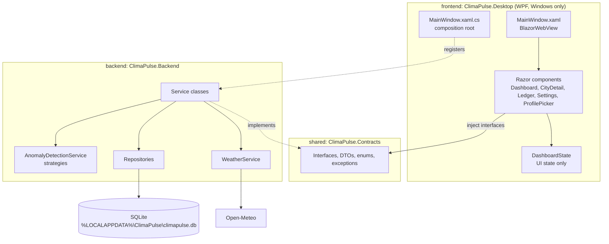

# ClimaPulse: Desktop Architecture and References

Status: draft for team review. Last updated 2026-10-22. Replaces `references-web-and-api.md` (the web and HTTP API design).

This file explains how ClimaPulse is built as a desktop app, how to set up the projects, and where to read more. The database schema (`backend/Database/schema.sql`) and the repositories are already done. The contract between frontend and backend is in `docs/api-contract.md`.

**Link status.** *Verified* means the page was opened or appeared in a live web search on the date shown. *Check* means it is a well-known official page I could not confirm from my environment, so open it once before relying on it.

---

## 1. Decisions

| Topic | Decision | Decided by |
|---|---|---|
| Platform | Windows desktop app, required by Module 1 ("C# desktop application: Windows Store, Windows Forms or WPF") | Module 1 |
| UI technology | WPF window hosting Blazor Hybrid (`BlazorWebView`). Screens are Razor components | Radit, 2026-10-22 |
| Frontend to backend | In-process C# interfaces in `shared/ClimaPulse.Contracts`. No HTTP API | Radit, 2026-10-22 |
| Users | No login. Profile picker on start | Radit, 2026-10-22 |
| Framework | .NET 10 LTS | Radit, 2026-10-16 |
| Database | SQLite through `Microsoft.Data.Sqlite`, existing ADO.NET repositories | Modul 4 |
| Repo layout | Monorepo: `frontend/`, `backend/`, `shared/` | Radit |
| Weather data | Open-Meteo forecast and archive APIs | PRD |
| Team machines | Everyone develops on Windows | Radit, 2026-10-22 |

### Why these choices, and what they cost

**A. WPF plus Blazor Hybrid instead of plain WPF**
- Pros: meets the Module 1 rule (it is a WPF app). Screens are written in Razor and CSS, so the web design references, component libraries and HTML layout skills still apply. Blazor knowledge also transfers to web work later.
- Cons: two UI worlds in one app (a little XAML for the window, Razor for everything inside it). Fewer course examples than plain WPF. Needs the WebView2 runtime on the PC.
- Alternative: plain WPF with XAML and MVVM. Closest to the course examples and needs no WebView2, but the team must learn XAML layout and data binding, and the design references transfer less directly.

**B. In-process services instead of an HTTP API**
- Pros: one program, one F5, nothing to start first. No ports, CORS or network errors between UI and logic, which protects the "demo runs without errors" grade (20 percent). The contract is checked by the compiler.
- Cons: a future web or mobile client would need an HTTP layer added on top of the same interfaces.

**C. Target frameworks**
- `shared/ClimaPulse.Contracts` and `backend`: `net10.0`. Their unit tests also run on Mac, Linux or a CI server.
- `frontend`: `net10.0-windows10.0.17763.0`, the target Microsoft's .NET 10 Blazor Hybrid WPF tutorial uses. The tutorial says .NET 10 needs Windows 10 or later because it switched to `WebView2CompositionControl`.
- Background: Microsoft's notice says .NET 8 and 9 stop being supported on 2026-11-10, which is why the project uses .NET 10.

**D. Keep the existing ADO.NET repositories**
- Pros: already written and tested. Cons: SQL is hand-written, so a column change touches two places. Revisit Entity Framework Core only if the schema changes a lot.

**E. Component library: MudBlazor, after a short check**
- Pros: free, Material look, tables, dialogs, snackbars, light and dark themes.
- Cons: basic charts. Blazor Hybrid support for MudBlazor is not confirmed from my environment (status Check). Spend 15 minutes adding one `MudButton` to the WPF app before the team commits to it. If it fails, use plain CSS or a library whose docs cover Blazor Hybrid (Telerik's documentation has a Blazor Hybrid getting-started page, but Telerik is a paid product).

---

## 2. Architecture



Layering rules:
1. Razor components inject only `ClimaPulse.Contracts` interfaces. Never a repository, `WeatherService` or another backend class.
2. Only `MainWindow.xaml.cs` (the composition root) knows the backend classes, to register them.
3. Services return DTOs, never `ClimaPulse.Models` entities.
4. Only `WeatherService` calls Open-Meteo.
5. Tier and z-score logic lives only in the backend.

---

## 3. Setup guide

Do these on a feature branch. You need Windows, the .NET 10 SDK (`dotnet --version` prints `10.x`), and Visual Studio 2022 or newer with the ".NET desktop development" workload, or VS Code with the C# Dev Kit.

### Step 1: Create the projects

```bash
# from the repo root, on a fresh branch
dotnet new classlib -n ClimaPulse.Contracts -o shared/ClimaPulse.Contracts
dotnet new classlib -n ClimaPulse.Backend   -o backend
dotnet new wpf      -n ClimaPulse.Desktop   -o frontend
dotnet new xunit    -n ClimaPulse.Backend.Tests -o tests/ClimaPulse.Backend.Tests
dotnet new sln -n ClimaPulse
dotnet sln add shared/ClimaPulse.Contracts backend frontend tests/ClimaPulse.Backend.Tests
dotnet add backend  reference shared/ClimaPulse.Contracts
dotnet add frontend reference shared/ClimaPulse.Contracts backend
dotnet add tests/ClimaPulse.Backend.Tests reference backend
dotnet add backend  package Microsoft.Data.Sqlite
dotnet add frontend package Microsoft.AspNetCore.Components.WebView.Wpf
```

Pitfalls:
- `dotnet new` writes `Class1.cs`, `App.xaml` and `MainWindow.xaml` into folders that already hold code. Check `git status` afterwards and delete only the generated `Class1.cs` files.
- `frontend/Program.cs` (an empty `Main`) must be removed. WPF generates its own entry point from `App.xaml`, and two entry points stop the build.
- Move `backend/Enums/*.cs` into `shared/ClimaPulse.Contracts/Enums/`, keeping the namespace `ClimaPulse.Enums`, so the UI can use them without referencing the backend. This is a file move, so agree on it first (AGENTS.md).
- Each package above needs team approval before it is added (AGENTS.md).

### Step 2: Turn the WPF project into a Blazor Hybrid project

Following Microsoft's .NET 10 WPF tutorial, change the top of `frontend/ClimaPulse.Desktop.csproj`:

```xml
<Project Sdk="Microsoft.NET.Sdk.Razor">
  <PropertyGroup>
    <OutputType>WinExe</OutputType>
    <TargetFramework>net10.0-windows10.0.17763.0</TargetFramework>
    <UseWPF>true</UseWPF>
    <Nullable>enable</Nullable>
    <ImplicitUsings>enable</ImplicitUsings>
    <RootNamespace>ClimaPulse.Desktop</RootNamespace>
  </PropertyGroup>
</Project>
```

The SDK changes from `Microsoft.NET.Sdk` to `Microsoft.NET.Sdk.Razor`, and the target framework gets the Windows version. Keep the other lines the template generated.

Add these files (shapes from the tutorial):
- `frontend/_Imports.razor` with at least `@using Microsoft.AspNetCore.Components.Web`, plus `@using ClimaPulse.Contracts` and `@using ClimaPulse.Enums`.
- `frontend/wwwroot/index.html` with `<div id="app">Loading...</div>` and `<script src="_framework/blazor.webview.js"></script>`.
- A root component (for example `Routes.razor` with a Router) and the pages.

### Step 3: Host Blazor in the window

`frontend/MainWindow.xaml` (inside the `Window` element, which declares `xmlns:blazor="clr-namespace:Microsoft.AspNetCore.Components.WebView.Wpf;assembly=Microsoft.AspNetCore.Components.WebView.Wpf"`):

```xml
<Grid>
    <blazor:BlazorWebView HostPage="wwwroot\index.html" Services="{DynamicResource services}">
        <blazor:BlazorWebView.RootComponents>
            <blazor:RootComponent Selector="#app" ComponentType="{x:Type local:Routes}" />
        </blazor:BlazorWebView.RootComponents>
    </blazor:BlazorWebView>
</Grid>
```

### Step 4: The composition root

`frontend/MainWindow.xaml.cs` is the only place where frontend code names backend classes:

```csharp
using System.Windows;
using ClimaPulse.Contracts;
using ClimaPulse.Repositories;
using ClimaPulse.Services;
using Microsoft.Extensions.DependencyInjection;

namespace ClimaPulse.Desktop;

public partial class MainWindow : Window
{
    // true while the backend is unfinished: screens use sample data from frontend/Fakes
    private static readonly bool UseFakes = true;

    public MainWindow()
    {
        InitializeComponent();

        var services = new ServiceCollection();
        services.AddWpfBlazorWebView();
#if DEBUG
        services.AddBlazorWebViewDeveloperTools();
#endif

        if (UseFakes)
        {
            // services.AddSingleton<IDashboardService, FakeDashboardService>();  and so on
        }
        else
        {
            var connectionString = DatabaseConfig.ConnectionString;
            DatabaseInitializer.EnsureCreated(connectionString,
                Path.Combine(AppContext.BaseDirectory, "Database", "schema.sql"));

            // Repositories are stateless and open a connection per call, so one instance is enough.
            services.AddSingleton(new CityRepository(connectionString));
            // ... the other six repositories

            // Open-Meteo: one shared HttpClient with a timeout, plus the two addresses.
            services.AddSingleton(new HttpClient { Timeout = TimeSpan.FromSeconds(20) });
            services.AddSingleton(new OpenMeteoOptions());
            services.AddSingleton<WeatherService>();

            // services.AddSingleton<IDashboardService, DashboardService>();  and so on, one per interface
        }

        services.AddSingleton<DashboardState>();   // current profile, last results
        Resources.Add("services", services.BuildServiceProvider());
    }
}
```

Why each piece exists:
- `AddWpfBlazorWebView` and `Resources.Add("services", ...)` are the two lines from the tutorial that connect dependency injection to the `BlazorWebView`.
- `UseFakes` lets the frontend developer build every screen before the backend is ready (contract section 10).
- `EnsureCreated` creates the tables on a new PC. Copy `schema.sql` to the output folder with `<Content Include="..\backend\Database\schema.sql" Link="Database\schema.sql" CopyToOutputDirectory="PreserveNewest" />` in the Desktop project.
- A single shared `HttpClient` is the simple, correct choice for one desktop process. `IHttpClientFactory` would need another package and solves server problems we do not have.
- Singleton lifetimes: there is one window, so singletons and scoped services behave the same here. Singletons are easier to reason about.

### Step 5: Database location and configuration

- Set the database path to `%LOCALAPPDATA%\ClimaPulse\climapulse.db` (create the folder on start). `DatabaseConfig` currently defaults to `climapulse.db` in the working folder, which may not be writable once the app is installed. `CLIMAPULSE_DB_PATH` still overrides it.
- .NET does not read `.env` files. `backend/.env.example` only documents the variable names. Open-Meteo needs no key, so there is nothing secret.
- Settings that are not in the database (last profile, theme) go in `%LOCALAPPDATA%\ClimaPulse\settings.json` (contract decision C3).

### Step 6: Test

- Unit tests (xUnit): `AnomalyDetectionService`, strategies, z-score and tier rules. No database, no network.
- Service tests: each interface method against a temporary SQLite file, checking DTO values and exception types.
- Manual demo path: pick profile, add city, refresh, see badge, open city detail, open ledger, export CSV. Run it on the demo laptop, not only on the developer's PC.
- Debugging the UI: `AddBlazorWebViewDeveloperTools` in Debug builds lets you open the browser developer tools inside the app (Ctrl+Shift+I) to inspect HTML and CSS.

### Step 7: Publish a demo build

```bash
dotnet publish frontend -c Release -r win-x64 --self-contained true -o publish/ClimaPulse
```

Zip the `publish/ClimaPulse` folder and attach it to a GitHub Release. Module 1 grades "access information for a product demo", so link that release from the README together with three lines of run instructions. A self-contained build runs on a PC without the .NET SDK. Check that the WebView2 Runtime is present on the demo laptop (it is part of current Windows installs, and Microsoft's distribution page explains the options if it is missing).

---

## 4. Reference links

### Desktop and Blazor Hybrid

| Topic | Link | Status |
|---|---|---|
| Build a WPF Blazor app (.NET 10 tutorial, used for steps 2 to 4) | https://learn.microsoft.com/aspnet/core/blazor/hybrid/tutorials/wpf | Verified 2026-10-22 (opened) |
| Blazor Hybrid overview | https://learn.microsoft.com/aspnet/core/blazor/hybrid | Verified 2026-10-22 |
| `BlazorWebView` for WPF, API reference | https://learn.microsoft.com/dotnet/api/microsoft.aspnetcore.components.webview.wpf.blazorwebview | Verified 2026-10-22 |
| WebView2 Runtime distribution | https://learn.microsoft.com/microsoft-edge/webview2/concepts/distribution | Verified 2026-10-22 |
| WebView2 Evergreen vs fixed version | https://learn.microsoft.com/microsoft-edge/webview2/concepts/evergreen-vs-fixed-version | Verified 2026-10-22 |
| .NET application publishing overview | https://learn.microsoft.com/dotnet/core/deploying/ | Verified 2026-10-22 |
| Single-file deployment | https://learn.microsoft.com/dotnet/core/deploying/single-file/overview | Verified 2026-10-22 |
| .NET 8 and 9 end of support notice | https://devblogs.microsoft.com/dotnet/dotnet-8-9-end-of-support/ | Verified 2026-10-16 |
| WPF documentation home | https://learn.microsoft.com/dotnet/desktop/wpf/ | Check |
| Dependency injection in .NET | https://learn.microsoft.com/dotnet/core/extensions/dependency-injection | Check |
| Blazor error boundaries | https://learn.microsoft.com/aspnet/core/blazor/fundamentals/handle-errors | Check |

### Database

| Topic | Link | Status |
|---|---|---|
| Microsoft.Data.Sqlite overview | https://learn.microsoft.com/dotnet/standard/data/sqlite/ | Check |
| Microsoft.Data.Sqlite on NuGet | https://www.nuget.org/packages/Microsoft.Data.Sqlite | Check |

### Weather data

| Topic | Link | Status |
|---|---|---|
| Open-Meteo forecast API docs | https://open-meteo.com/en/docs | Verified 2026-10-22 (opened) |
| Open-Meteo historical (archive) API docs | https://open-meteo.com/en/docs/historical-weather-api | Verified 2026-10-22 (opened) |
| Open-Meteo geocoding API (city search, contract decision C2) | https://open-meteo.com/en/docs/geocoding-api | Verified 2026-10-22 (opened) |
| Open-Meteo terms | https://open-meteo.com/en/terms | Verified 2026-10-22 (opened) |

Confirmed on those pages on 2026-10-22: free use is non-commercial, under CC BY 4.0, limited to less than 600 calls per minute, 5,000 per hour, 10,000 per day and 300,000 per month per IP address. ERA5 and ERA5-Land archive data has about a 5-day delay. The endpoints, variables and units the backend uses are fixed in `docs/api-contract.md`, section 14. Cache every archive response in `HistoricalObservation` so a city is never downloaded twice.

### UI components and charts

| Topic | Link | Status |
|---|---|---|
| MudBlazor | https://github.com/MudBlazor/MudBlazor | Verified 2026-10-16 (Hybrid support: Check) |
| Telerik UI for Blazor, Blazor Hybrid getting started (paid, reference only) | https://docs.telerik.com/blazor-ui/getting-started/hybrid-blazor | Verified 2026-10-22 |
| Chart.js (charts through JavaScript interop) | https://www.chartjs.org/ | Check |

Charts in a Blazor Hybrid app work the same way as on the web: a pure Blazor chart component, or a JavaScript library such as Chart.js called through JavaScript interop. Start with simple tables and one chart. Add a map only if time remains.

---

## 5. Known pitfalls

1. **Time zones.** The database stores UTC (`yyyy-MM-ddTHH:mm:ssZ`). Convert to the city's `timezone` only in the UI.
2. **Decimal separator.** Indonesian Windows writes `29,1`. Use `CultureInfo.InvariantCulture` for export files and for any number sent to Open-Meteo in a URL. Reading coordinates with the wrong culture silently sends a wrong place.
3. **Frozen window.** Razor components run on the UI thread. Await every service call. Long database or calculation work goes into `Task.Run` in the backend. Never call `.Result` or `.Wait()` in a component, because that can deadlock the window.
4. **Month baselines.** One row per city, metric and calendar month, computed from about 30 years of data. Compute once, store, refresh with the existing upsert, and show progress.
5. **Duplicate ledger rows.** Open one `AnomalyEvent` when a reading crosses the threshold, keep it `active`, close it when readings return below the closing threshold (hysteresis, SRD OPEN-1).
6. **Snapshots.** Copy the baseline mean and standard deviation into the event when it opens. Never join back to `Baseline` to show an old event.
7. **Zero standard deviation.** `stddev_value` may be 0. Return `DataStatus.ZeroVariance` instead of dividing.
8. **SQLite single writer.** Do not run a baseline refresh and a live refresh for the same city at the same time. The contract makes the second call throw `ConflictException`.
9. **Database file location.** A program installed in a protected folder cannot write next to its `.exe`. Use `%LOCALAPPDATA%`.
10. **`wwwroot` not copied.** If the window shows a blank page, check that `wwwroot/index.html` is in the build output and that `HostPage` matches its path.

---

## 6. Suggested build order

1. Create the solution and projects. The window opens and shows one Razor component.
2. Contracts project: enums (moved), DTOs, interfaces, exceptions (copy from `docs/api-contract.md`).
3. Frontend: fakes for every interface, then the profile picker and dashboard against the fakes.
4. Backend in parallel: `IProfileService`, `ICityService`, `IWatchlistService` on the existing repositories, with service tests.
5. `WeatherService` live fetch, then archive fetch and `IBaselineService`.
6. `AnomalyDetectionService`, the temperature strategy, event logging, `IMonitoringService` and `IDashboardService`.
7. Switch `UseFakes` off. Ledger page with CSV and JSON export.
8. Publish the demo build and run the demo path on the demo laptop.
9. Precipitation and wind strategies, twin cities and impact estimates if time remains.

Requirements and open decisions are in `docs/SRD.md`. The contract is in `docs/api-contract.md`.
